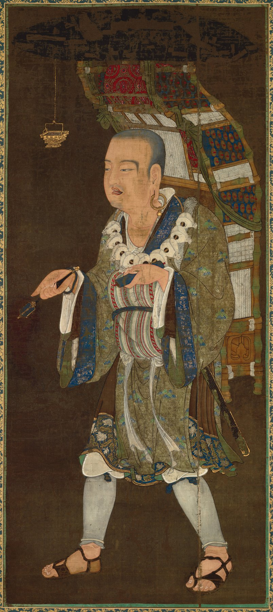
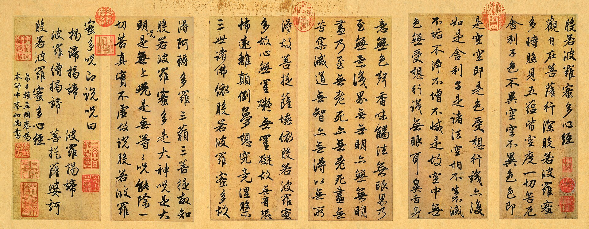
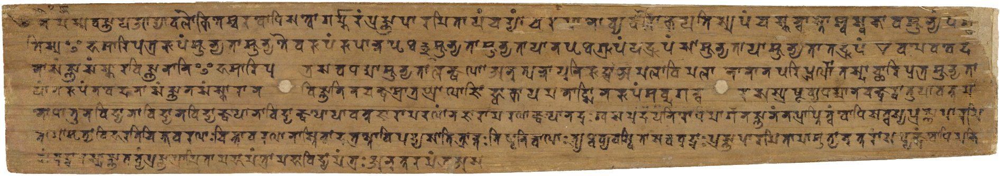
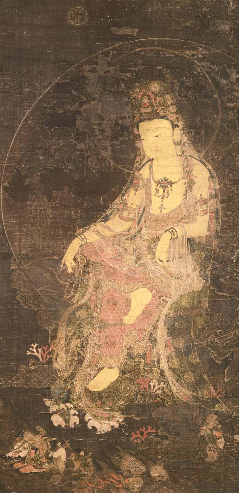

# 반야바라밀다심경 — 전문·구절별 풀이·해설

> 唐 三藏法師 玄奘 譯 
> 당나라 삼장법사 현장 번역

## 문서 안내

> [생략 없는 한자 원문·글자별 한글 독음 보기](전문_한자음/반야심경/README.md) — 연결된 전문 파일은 CBETA 자료의 배열을 따라 `明太祖御製般若心經序`(명 태조 어제 반야심경 서문)부터 시작하며, 경 본문은 그 뒤에 나온다.

《반야바라밀다심경》(般若波羅蜜多心經), 줄여서 《반야심경》은 방대한 반야경의 핵심을 매우 짧게 압축한 경전이다. 이 문서는 현장 한역본인 대정신수대장경 T08 No. 251을 기준으로 전문을 8개의 의미 단위로 나누어 풀이한다.

여기서 `공(空)`은 아무것도 존재하지 않는다는 뜻이 아니다. 몸과 마음을 포함한 모든 현상이 독립되고 영원한 자성 없이 여러 조건에 의존해 생긴다는 통찰이다. 따라서 `무(無)`의 반복도 경험과 윤리를 지우는 말이 아니라, 그것들을 고정된 실체로 붙잡을 수 없다는 뜻으로 읽는다.

각 절의 `원문` 아래에는 한글 독음을 붙였다. 독음은 우리나라 절에서 독송하는 소리를 따랐으므로 `不垢不淨`은 `불구부정`, `不增不減`은 `부증불감`, `罣礙`는 `가애`로 읽고, 마지막 진언 `揭帝 揭帝 般羅揭帝…`는 글자 음(게제 게제 반라게제…) 대신 전통 독송음 `아제 아제 바라아제 바라승아제 모지 사바하`로 적었다.

이 문서의 `우리말 풀이`는 한문 어순을 그대로 옮긴 축자역이 아니라 문맥과 뜻을 살린 의역이다. 의역에는 `고정된`, `독립된 실체로` 같은 해석의 말이 들어가므로, 각 절에 `글자대로 옮기면`(직역)을 따로 두어 원문에 실제로 있는 말과 풀이에서 보탠 말을 견주어 볼 수 있게 했다. 원문의 낱글자와 한글 독음은 위 전문 문서에서 함께 확인할 수 있다.

산스크리트 원문에서 확인되는 핵심 용어는 해당 절의 해설에 `산스크리트어 풀이`로, 뜻을 새겨 둘 만한 한자는 `한자 풀이`로, 판본에 따라 달라지는 대목은 `판본 차이`로 따로 표시했다. 같은 용어가 반복될 때에는 처음 또는 뜻이 중요하게 확장되는 대목에서 설명한다.

## 경 제목 풀이

우리나라 절에서는 이 경을 대개 `마하반야바라밀다심경`(摩訶般若波羅蜜多心經)이라는 제목으로 독송한다. 현장 역본의 본래 제목에는 `마하`가 없고, 독송 전통에서 앞에 덧붙인 것이다. 제목의 글자 하나하나가 경 전체의 요약이다.

| 글자 | 원어 | 뜻 |
|---|---|---|
| 마하(摩訶) | mahā | 크다. 크기를 견주는 큼이 아니라 견줄 대상이 없을 만큼 넓고 깊다는 뜻 |
| 반야(般若) | prajñā | 지혜. 지식을 많이 쌓는 앎이 아니라 사물이 조건에 의존해 있음을 꿰뚫어 보는 앎 |
| 바라밀다(波羅蜜多) | pāramitā | 저 언덕에 이름·완성. 괴로움의 이쪽 언덕에서 자유의 저쪽 언덕으로 건너가는 실천 |
| 심(心) | hṛdaya | 심장·핵심. 마음(citta)이 아니라 `방대한 반야경의 심장부`라는 뜻 |
| 경(經) | sūtra | 날실처럼 가르침을 꿰어 놓은 경전 |

곧 제목은 `크나큰 지혜로 저 언덕에 건너가는 가르침의 핵심 경전`이라는 뜻이다. `심(心)`을 `마음`으로만 읽어 `마음에 관한 경`이라고 이해하기 쉽지만, 원어 `hṛdaya`는 `가장 중요한 부분`이라는 뜻이 강하다.

## 반야심경은 어떤 경전인가

- **가장 짧은 반야경:** 반야 계통 경전은 현장이 번역한 《대반야바라밀다경》만 해도 600권에 이른다. 반야심경은 그 핵심을 제목을 빼고 260자에 담았다. 이 문서의 원문 여덟 절을 세어도 정확히 260자다.
- **소본과 대본:** 현장 역본처럼 `관자재보살…`로 곧바로 시작해 진언으로 끝나는 짧은 형태를 `소본(小本)`이라 한다. 이와 달리 `이와 같이 나는 들었다`(如是我聞)로 시작하는 `대본(大本)`이 따로 전한다. 대본에서는 부처님이 영취산에서 깊은 삼매에 드시고, 사리자가 부처님의 위신력을 받아 `깊은 반야바라밀다를 행하려면 어떻게 배워야 하는가`를 관자재보살에게 묻는다. 관자재보살의 대답이 소본의 내용이고, 끝에 부처님이 삼매에서 나와 `훌륭하다`고 인가하시며 대중이 기뻐한다. 소본에서 갑자기 `사리자여`라고 부르는 까닭이 이 장면에 있다.
- **누가 말하는가:** 대본을 따르면 소본의 말씀은 관자재보살이 사리자에게 하는 대답이다. 소본만으로는 화자가 드러나지 않아 부처님이 사리자에게 하신 말씀으로 읽는 전통도 있다.
- **우리나라에서의 자리:** 반야심경은 새벽·저녁 예불과 거의 모든 법회·의식에서 독송되어, 한국 불자에게 가장 널리 외워지는 경전이다. 현장의 제자였던 신라 출신 원측(圓測, 613~696)이 이 경의 주석서 《반야바라밀다심경찬》을 지었을 만큼 우리와 인연이 깊다.
- **현장과 반야심경:** 현장의 전기 《대자은사삼장법사전》에는 그가 촉(蜀) 땅에서 병든 사람을 돌보아 주고 이 경을 받았으며, 서역으로 가는 사막 길에서 무서운 일을 만날 때마다 이 경을 외워 벗어났다는 이야기가 실려 있다. 역사 기록이라기보다 이 경이 일찍부터 `두려움을 건너게 하는 경`으로 받아들여졌음을 보여 주는 전승이다.

*그림 1. 〈현장삼장상(玄奘三藏像)〉, 일본 가마쿠라 시대 14세기, 비단에 채색, 도쿄국립박물관 소장(A-10600). 경전을 가득 실은 등짐을 지고 먼 길을 걷는 모습으로, 전통적으로 서역 구법길의 현장을 그린 것으로 전해 온다. 사막에서 반야심경을 외우며 두려움을 건넜다는 전승과 함께 보면 좋다. 퍼블릭 도메인, 출처: [위키미디어 공용](https://commons.wikimedia.org/wiki/File:Xuanzang_w.jpg)*

### 여러 한역본

| 대정장 번호 | 경 제목 | 번역자 | 형태 |
|---|---|---|---|
| T250 | 摩訶般若波羅蜜大明呪經 | 구마라집 번역으로 전함 | 소본 |
| T251 | 般若波羅蜜多心經 | 현장(649년 번역으로 전함) | 소본 · 이 문서의 저본 |
| T252 | 普遍智藏般若波羅蜜多心經 | 법월 | 대본 |
| T253 | 般若波羅蜜多心經 | 반야·이언 | 대본 |
| T254 | 般若波羅蜜多心經 | 지혜륜 | 대본 |
| T255 | 般若波羅蜜多心經 | 법성(돈황본) | 대본 |
| T257 | 佛說聖佛母般若波羅蜜多經 | 시호 | 대본 |

구마라집 역본은 `관자재` 대신 `관세음`, `오온` 대신 `오음(五陰)`이라 하는 등 옛 번역어를 쓴다. 동아시아에서 독송되는 것은 거의 모두 현장 역본이다.

*그림 2. 원나라 서예가 조맹부(趙孟頫, 1254~1322)가 쓴 반야심경. 오른쪽 끝 `般若波羅蜜多心經 觀自在菩薩…`에서 시작해 왼쪽으로 읽어 가며, 맨 왼쪽에 `제자 조맹부가 본사 중봉 화상을 위해 받들어 쓰다`(弟子趙孟頫奉為本師中峯和尚書)라는 맺음글이 있다. 진언이 대정장의 `揭帝`가 아니라 `揭諦`로 적혀 있어, 널리 유포된 판본의 글자를 따랐음을 볼 수 있다. 퍼블릭 도메인, 출처: [위키미디어 공용](https://commons.wikimedia.org/wiki/File:Prajnyaapaaramitaa_Hridaya_by_Zhao_Meng_Fu_Main_Part.jpg)*

*그림 3. 일본 호류지(法隆寺)에 전해 온 패엽(다라수 잎) 사본의 첫째 잎, 7~8세기 무렵 필사로 추정, 도쿄국립박물관 소장(호류지 헌납보물 N-8). 실담(悉曇) 문자로 산스크리트 소본 반야심경이 적혀 있으며, 현존하는 가장 오래된 산스크리트 사본 가운데 하나로 꼽힌다. 퍼블릭 도메인, 출처: [위키미디어 공용](https://commons.wikimedia.org/wiki/File:Heart_Sutra_on_Palm_Leaves_1_%28TNM_N-8%29.jpg)*

## 경에 나오는 두 인물

| 인물 | 원어 | 누구인가 |
|---|---|---|
| 관자재보살(觀自在菩薩) | Avalokiteśvara | 우리에게 익숙한 `관세음보살`과 같은 보살이다. 원어를 `avalokita`(굽어봄) + `īśvara`(자재한 이)로 읽으면 현장의 `관자재`, `avalokita` + `svara`(소리)로 읽으면 구마라집의 `관세음`이 된다. 자비의 상징인 보살이 지혜의 경을 설한다는 데서 지혜와 자비가 둘이 아님을 읽을 수 있다. |
| 사리자(舍利子) | Śāriputra | 사리불(舍利弗)이라고도 한다. `사리(Śārī)라는 어머니의 아들`이라는 뜻이다. 부처님 제자 가운데 `지혜제일`로 꼽히며, 존재를 요소로 나누어 분석하는 아비달마 전통의 대표로 여겨진다. 그런 그에게 `분석의 단위인 오온과 법마저 공하다`고 일러 주는 것이 이 경의 극적인 장치다. |

*그림 4. 〈수월관음도(水月觀音圖)〉, 고려 14세기 전반, 비단에 채색, 미국 메트로폴리탄 미술관 소장. 물가 바위에 앉은 관음보살이 투명한 사라를 두르고 아래를 굽어보고 있다. `굽어보는(avalokita) 자재한 이`라는 관자재보살의 이름, 그리고 제1절의 `비추어 보았다(vyavalokayati)`는 말과 함께 보면 그 뜻이 그림으로 살아난다. 퍼블릭 도메인, 출처: [위키미디어 공용](https://commons.wikimedia.org/wiki/File:Water-Moon_Avalokiteshvara_%28Metropolitan_Museum_of_Art%29.jpg)*

## 경의 짜임

경은 짧지만 불교의 기본 교리를 차례로 불러내어 하나씩 `공`의 눈으로 다시 보게 하는 정교한 짜임을 가지고 있다.

| 절 | 내용 | 다루는 교리 | 전통적 갈래 |
|---|---|---|---|
| 1 | 관자재보살이 오온의 공함을 비추어 봄 | 오온 | 경 전체의 요지 |
| 2~3 | 색즉시공, 모든 법의 공한 모습 | 공과 현상의 관계 | 공의 이치 |
| 4 | 오온·십이처·십팔계가 없음 | 삼과(三科) — 존재를 분류하는 세 방식 | 범부가 `나와 세계`로 붙드는 것 |
| 5 앞 | 무명에서 노사까지, 그 소멸까지 없음 | 십이연기 | 연각(緣覺)의 수행 |
| 5 중간 | 고·집·멸·도가 없음 | 사성제 | 성문(聲聞)의 수행 |
| 5 끝 | 지혜도 얻음도 없음 | 지혜와 그 결과 | 보살의 수행 |
| 6 | 걸림 없음 → 두려움 없음 → 열반 → 깨달음 | 수행의 결실 | 보살과 부처의 과(果) |
| 7~8 | 반야를 주문으로 찬탄하고 진언을 설함 | 진언 | 드러내어 설한 반야(顯說)를 감추어 설한 반야(密說)로 맺음 |

`전통적 갈래` 칸은 법장(法藏)의 《반야심경약소》 등 동아시아 주석서에서 널리 쓰인 읽기다. 4~5절의 긴 `무(無)`의 목록이 아무렇게나 늘어놓은 부정이 아니라, 범부의 세계관부터 성문·연각·보살의 가르침까지 단계적으로 짚어 가며 `어느 단계의 가르침도 붙들 실체는 아니다`라고 말하는 구조라는 점을 보여 준다.

## 핵심 용어

| 용어 | 이 문서의 풀이 |
|---|---|
| 반야(般若) | 모든 현상을 독립된 실체로 붙들지 않고 연기와 공의 이치로 보는 지혜 |
| 바라밀다(波羅蜜多) | 집착과 괴로움의 언덕에서 지혜와 자유의 저 언덕으로 건너가는 완성된 실천 |
| 오온(五蘊) | 몸과 마음의 경험을 이루는 색·수·상·행·식의 다섯 무더기 |
| 공(空) | 모든 것이 독립되고 고정된 자성 없이 조건에 의존해 성립한다는 성질 |
| 자성(自性) | 다른 것에 기대지 않고 스스로 존재하며 변하지 않는 고유한 본질. 공은 바로 이 자성이 `비어 있음`을 말한다 |
| 연기(緣起) | 모든 것이 원인과 조건이 모여 생기고, 조건이 흩어지면 사라진다는 이치. 공은 연기를 다른 쪽에서 본 이름이다 |
| 법(法) | 여기서는 가르침보다 `경험되는 모든 현상·요소`를 뜻한다 |
| 십이처·십팔계 | 감각 기관과 그 대상(십이처)에 여섯 의식을 더해(십팔계) 경험 전체를 나눈 분류 |
| 십이연기 | 무명에서 늙음·죽음까지 괴로움이 열두 고리의 조건으로 이어지는 과정 |
| 사성제(四聖諦) | 괴로움(고)·그 원인(집)·소멸(멸)·소멸에 이르는 길(도)의 네 가지 진리 |
| 무소득(無所得) | 깨달음과 공덕까지도 고정된 소유물이나 자기 지위로 붙들지 않는 태도 |
| 전도몽상(顚倒夢想) | 무상한 것을 영원하다고 보는 것처럼 실상을 거꾸로 보는 생각 |
| 보리살타(菩提薩埵) | 지혜와 자비로 자신과 모든 존재의 깨달음을 구하는 보살 |
| 아뇩다라삼먁삼보리 | 위없이 바르고 평등한 깨달음(無上正等正覺). 부처의 깨달음 |
| 주(呪)·진언(眞言) | 가르침의 힘을 압축한 소리. 이 경에서는 반야 자체를 가장 높은 주문이라 찬탄한다 |

## 1. 오온이 모두 공함을 비추어 보다

### 원문

> 觀自在菩薩行深般若波羅蜜多時，照見五蘊皆空，度一切苦厄。
>
> 관자재보살 행심반야바라밀다시, 조견오온개공, 도일체고액.

### 글자대로 옮기면

관자재보살이 깊은 반야바라밀다를 행할 때, 오온이 모두 공함을 비추어 보고, 모든 괴로움과 재액을 건넜다.

### 우리말 풀이

관자재보살이 깊은 반야바라밀다를 실천할 때, 몸과 마음을 이루는 다섯 무더기가 모두 공함을 밝게 비추어 보고 모든 괴로움과 재난을 건넜다.

### 해설

- 오온은 물질적 몸과 현상인 `색`, 느낌인 `수`, 대상의 특징을 붙잡아 개념 짓는 지각인 `상`, 의지와 여러 심리 작용인 `행`, 대상을 알아차리는 의식인 `식`이다.
- `모두 공하다`는 것은 오온이 작동하지 않는다는 말이 아니라, 어느 것도 홀로 영원한 `나`가 될 수 없다는 뜻이다.
- 괴로움에서 벗어나는 길은 몸과 감정을 미워하는 데 있지 않고, 그것들을 나의 고정된 본질로 움켜쥐지 않는 데 있다.
- 오온을 쉽게 말하면 `몸`, `느낌`, `무엇인지 알아보는 작용`, `마음의 반응과 의지`, `알아차림`이다. 우리가 `나`라고 부르는 경험은 이 다섯 가지가 잠시 함께 움직이는 과정이다.
- 예를 들어 누군가의 말을 들으면 귀와 몸이 소리를 받고, 기분이 생기고, 그 말을 칭찬이나 비난으로 알아보며, 대답하고 싶은 충동이 일어나고, 이 모든 것을 의식한다. 어느 한 요소만 떼어 내 완전한 `나`라고 할 수 없다.
- 오온은 늘 변한다. 몸은 나이를 먹고, 기분은 좋아졌다 나빠지며, 생각과 기억도 새로운 경험에 따라 달라진다. 변하는 것을 변하지 않는 나라고 붙들 때 현실과 기대가 어긋나 괴로움이 커진다.
- `비추어 본다`는 것은 머리로 공이라는 답을 외우는 것보다 지금 일어나는 몸과 마음을 차분히 관찰한다는 뜻이다. 화가 날 때도 `나는 화난 사람이다`라고 단정하기보다 몸의 긴장, 불쾌한 느낌, 떠오르는 생각을 나누어 살펴볼 수 있다.
- 공하다고 해서 책임이 없어지는 것은 아니다. 말과 행동은 다른 사람에게 영향을 주고 그 결과가 다시 나에게 돌아온다. 다만 잘못을 `나는 원래 나쁜 사람`이라는 본질로 만들지 않으므로 더 솔직하게 인정하고 고칠 수 있다.
- 몸이 공하다는 말은 몸을 소홀히 하라는 뜻도 아니다. 몸은 음식·잠·환경·돌봄에 의존하므로, 오히려 필요한 조건을 잘 마련해야 건강을 지킬 수 있다는 뜻으로 이어진다.
- 모든 괴로움이 공을 이해하는 순간 즉시 사라지는 것은 아니다. 질병이나 상실의 아픔은 남을 수 있지만, `이 고통은 영원할 것이다`, `이 일이 나의 전부다`라는 두 번째 괴로움을 덜 수 있다.
- **산스크리트어 풀이:** `Prajñāpāramitā`(프라즈냐파라미타)는 `prajñā`(반야, 꿰뚫어 보는 지혜)와 `pāramitā`(바라밀다, 완성·저 언덕에 이름)의 결합이다. `bodhisattva`(보디사트바)는 `bodhi`(깨달음)와 `sattva`(존재)를 합친 말로, 깨달음을 구하며 중생을 돕는 보살을 뜻한다.
- **산스크리트어 풀이:** `pañca-skandha`(판차 스칸다)는 `다섯 무더기`라는 뜻으로 한역의 오온(五蘊)에 해당한다. `śūnya`는 `비어 있는`, `śūnyatā`(슈냐타)는 `공함·공성`을 뜻하며, 존재하지 않는다는 말보다 독립된 자성이 비어 있다는 뜻에 가깝다.
- **산스크리트어 풀이:** 산스크리트 소본은 이 대목을 `오온이 있음을 보았고, 그것들이 자성이 공함(svabhāva-śūnya)을 보았다`고 적는다. 오온이 `있음`을 먼저 인정한 뒤 그 `자성`이 비어 있음을 본다는 이 순서가, 공을 `아무것도 없음`이 아니라 `고정된 본질이 없음`으로 읽어야 하는 원문상의 근거다.
- **산스크리트어 풀이:** `비추어 보았다`에 해당하는 동사 `vyavalokayati`(브야바로카야티, 굽어보다)는 보살의 이름 `Avalokiteśvara`(굽어보는 자재자)와 같은 어근이다. `굽어보는 이`가 이름 그대로 세상을 깊이 굽어보았다는 말놀이가 들어 있다.
- **한자 풀이:** `조견(照見)`의 `조(照)`는 등불이 어둠을 비추듯 환히 비춘다는 뜻이다. 생각으로 따져서 아는 것이 아니라, 밝은 빛 아래 사물이 저절로 드러나듯 있는 그대로 보는 것을 가리킨다. `고액(苦厄)`의 `고`는 마음이 겪는 괴로움, `액`은 바깥에서 닥치는 재난·곤경이다.
- **한자 풀이:** `행심반야(行深般若)`에서 반야는 `안다`가 아니라 `행한다`의 목적어다. 반야는 책으로 익히는 지식이 아니라 몸과 마음으로 실천하는 것임을 첫 문장부터 밝힌다. 전통 주석가들은 `깊은(深)` 반야를 `나`가 공함(人空)만 보는 데 그치지 않고 나를 이루는 요소들까지 공함(法空)을 보는 지혜로 풀이하곤 했다.
- **판본 차이:** `도일체고액(度一切苦厄)`, 곧 `모든 괴로움과 재액을 건넜다`는 구절은 현존 산스크리트 소본에는 없고 한역본에 보인다. 경의 결론인 `능제일체고`(모든 괴로움을 없앤다, 제7절)를 첫머리에서 미리 밝혀 경 전체의 목적을 앞에 세워 둔 셈이다.

## 2. 색과 공은 서로 떨어져 있지 않다

### 원문

> 舍利子！色不異空，空不異色；色即是空，空即是色。受、想、行、識，亦復如是。
>
> 사리자! 색불이공, 공불이색; 색즉시공, 공즉시색. 수·상·행·식, 역부여시.

### 글자대로 옮기면

사리자여, 색은 공과 다르지 않고 공은 색과 다르지 않으며, 색이 곧 공이요 공이 곧 색이다. 수·상·행·식도 또한 이와 같다.

### 우리말 풀이

사리자여, 물질적 현상은 공과 다르지 않고 공은 물질적 현상과 다르지 않다. 물질적 현상이 곧 공이며 공이 곧 물질적 현상이다. 느낌·표상·의지 작용·의식도 이와 같다.

### 해설

- 공은 현상 뒤에 숨어 있는 별개의 세계가 아니다. 현상이 조건에 의존해 성립하는 바로 그 방식이 공이다.
- `색즉시공`은 몸과 세계를 부정하지 않으며, `공즉시색`은 공을 현실과 동떨어진 관념으로 만들지 않는다.
- 감정도 조건 따라 생기고 변한다. 그러므로 감정을 억압하지 않으면서도 `이 감정이 영원한 나`라는 동일시에서 벗어날 수 있다.
- 여기서 `색`은 단순히 눈에 보이는 색깔이 아니라 몸과 물질을 포함한 모든 물질적 현상을 뜻한다. 의자, 나무, 몸처럼 단단해 보이는 것도 재료·시간·온도·사용 같은 조건에 의존한다.
- 의자를 예로 들면 나무, 못, 만든 사람, 운반, 사용하는 사람이 모여 있을 때 의자라는 기능과 이름이 생긴다. 이런 조건을 모두 떠난 `의자 자체`는 찾을 수 없다는 것이 공의 쉬운 뜻이다.
- 그렇다고 의자에 앉을 수 없다는 말은 아니다. 공은 `없다`가 아니라 `혼자서, 영원히, 변함없이 존재하지 않는다`는 뜻이다. 조건으로 이루어졌기 때문에 실제로 기능하고 또 변할 수 있다.
- `색이 곧 공`은 눈앞의 현실을 자세히 보면 그 안에서 바로 조건 의존성을 발견할 수 있다는 말이다. 현실을 떠나 별도의 공 세계로 가야 하는 것이 아니다.
- `공이 곧 색`은 공이 텅 빈 무언가로 따로 존재하지 않는다는 말이다. 공은 언제나 구체적인 몸, 사물, 감정과 관계가 성립하는 방식으로 나타난다.
- 느낌·생각·의지·의식도 마찬가지다. 피곤할 때 들은 말과 편안할 때 들은 말이 다르게 느껴지는 것처럼 마음은 몸 상태, 기억, 관계와 환경의 영향을 받는다.
- 이 통찰은 감정을 무시하지 않으면서 감정에 끌려가지 않도록 돕는다. `지금 화가 있다`고 인정하되 `그러므로 반드시 공격해야 한다`고 결론 내리지 않고 다른 대응을 선택할 여지가 생긴다.
- 네 구절은 두 단계로 짜여 있다. `불이(不異)`, 곧 `다르지 않다`는 색과 공을 둘로 떼어 놓는 생각을 부정하고, `즉시(卽是)`, 곧 `바로 그것이다`는 한 걸음 더 나아가 둘이 하나의 사실을 두 쪽에서 본 것임을 확인한다. 앞은 `떨어져 있지 않다`, 뒤는 `같은 자리에 있다`는 말이다.
- `역부여시(亦復如是)`는 `수불이공 공불이수 수즉시공 공즉시수…`를 나머지 네 온마다 되풀이해야 할 것을 한마디로 줄인 것이다. 느낌·생각·의지·의식 하나하나에 이 네 구절을 대어 보면 뜻이 훨씬 구체적으로 다가온다. 예를 들어 `느낌이 곧 공`이라는 것은 지금의 서운함도 몸 상태·기억·상대의 말이라는 조건이 모여 일어난 것이니 영원히 고정된 서운함은 없다는 뜻이다.
- `색즉시공`은 널리 알려진 만큼 오해도 많다. 여기의 `색`은 색욕(色慾)의 색이 아니라 물질적 현상(rūpa)이며, `공`은 허무가 아니다. `세상만사 다 부질없다`는 체념의 말로 쓰는 것은 경의 뜻과 거리가 멀다.
- **인물:** 여기서 처음 불리는 사리자는 지혜제일의 제자다. 누구보다 정밀하게 존재를 분석하던 이에게 `분석해 낸 요소들마저 실체가 아니다`라고 일러 주는 장면이므로, 이 경은 초심자뿐 아니라 교리를 많이 아는 사람에게 더 날카롭게 다가오는 경이기도 하다.
- **산스크리트어 풀이:** 산스크리트 소본은 `rūpaṃ śūnyatā, śūnyataiva rūpam`(색은 공이요, 공이 바로 색이다)을 먼저 말하고, 이어서 `색과 따로 공이 없고 공과 따로 색이 없다`(rūpān na pṛthak śūnyatā…)고 한 뒤, `무엇이든 색인 것 그것이 공이요, 무엇이든 공인 것 그것이 색이다`(yad rūpaṃ sā śūnyatā, yā śūnyatā tad rūpam)로 맺는다. 현장은 이를 `불이`와 `즉시`의 네 구절로 간결하게 정리했다.
- **산스크리트어 풀이:** 오온의 원어는 `rūpa`(루파, 물질·몸), `vedanā`(베다나, 느낌), `saṃjñā`(상즈냐, 특징을 알아보는 지각), `saṃskāra`(상스카라, 의지와 형성 작용), `vijñāna`(비즈냐나, 분별하여 알아차리는 의식)이다. 한글 표기는 발음을 돕는 근사치이며, 핵심은 다섯 기능이 함께 경험을 이룬다는 데 있다.

## 3. 모든 법의 공한 모습

### 원문

> 舍利子！是諸法空相，不生不滅，不垢不淨，不增不減。
>
> 사리자! 시제법공상, 불생불멸, 불구부정, 부증불감.

### 글자대로 옮기면

사리자여, 이 모든 법은 공한 모습이니, 생기지도 않고 멸하지도 않으며, 더럽지도 않고 깨끗하지도 않으며, 늘지도 않고 줄지도 않는다.

### 우리말 풀이

사리자여, 이 모든 법은 공함을 그 모습으로 한다. 그러므로 고정된 실체로서 생겨나거나 사라지는 것이 아니며, 본래부터 더럽거나 깨끗한 것도 아니고, 고정된 무엇이 늘거나 줄어드는 것도 아니다.

### 해설

- 현상 차원에서는 생겨남과 사라짐, 더러움과 깨끗함, 늘어남과 줄어듦이 분명히 작동한다. 이 문장은 그런 차별을 부정하기보다 그 배후에 불변하는 실체가 없다고 밝힌다.
- `더럽지도 깨끗하지도 않다`는 말은 선악이 같다는 뜻이 아니다. 사람이나 현상을 영원히 순수하거나 오염된 본질로 규정하지 말라는 뜻이다.
- 조건이 바뀌면 변화할 수 있으므로 수행과 치유가 가능하다.
- `모든 법`에서 법은 불교 교리만이 아니라 우리가 경험하고 생각할 수 있는 모든 현상을 뜻한다. 몸, 감정, 관계, 물건, 사회적 역할도 여기에 포함된다.
- `생기지도 사라지지도 않는다`는 말은 눈앞의 출생과 죽음이 없다는 뜻이 아니다. 완전히 독립된 실체가 무에서 홀로 생겨났다가 흔적 없이 없어지는 방식으로 존재하지 않는다는 뜻이다.
- 씨앗이 싹이 되려면 흙·물·햇빛·온도가 필요하다. 싹은 씨앗과 완전히 같은 것도 아니고 전혀 관계없는 것도 아니다. 생멸은 이렇게 조건이 바뀌며 이어지는 과정이다.
- 더러움과 깨끗함도 상황과 기준에 따라 정해진다. 흙은 옷에 묻으면 때라고 하지만 밭에서는 생명을 기르는 바탕이다. 이름과 평가가 대상의 영원한 본질은 아니다.
- 그렇다고 위생이나 윤리의 구별을 버리라는 뜻은 아니다. 손을 씻고 해로운 행동을 멈추는 일은 필요하지만, 아픈 사람이나 잘못한 사람을 영원히 `더러운 존재`로 낙인찍어서는 안 된다.
- 늘고 줄어드는 것도 비교와 조건 속에서 하는 말이다. 돈이 늘어도 불안이 커질 수 있고, 소유가 줄어도 자유가 커질 수 있다. 하나의 수치로 사람과 삶 전체를 평가할 수 없다.
- 공한 모습은 변화 가능성의 근거다. 성격과 습관이 고정 본질이라면 아무도 달라질 수 없지만, 조건으로 형성되었기에 연습·도움·환경 변화로 새로운 방향을 만들 수 있다.
- **풀이의 주어:** `시제법공상(是諸法空相)`은 `모든 법의 공한 모습은…`으로 읽기 쉽지만, 산스크리트 원문에 비추면 주어는 `모든 법`이고 `공상`은 그 법들의 성질이다. 곧 `공한 모습`이라는 별도의 무엇이 있어 생멸하지 않는 것이 아니라, 눈앞의 모든 현상이 공을 특징으로 하기에 고정된 생멸이 없다는 뜻이다. 이 문서의 우리말 풀이도 이에 맞추어 `이 모든 법은 공함을 그 모습으로 한다`고 옮겼다.
- **여섯 가지 부정(六不):** 세 쌍은 각각 다른 차원을 다룬다. `불생불멸`은 존재가 생기고 사라지는 시간의 차원, `불구부정`은 좋고 나쁨을 매기는 가치의 차원, `부증불감`은 많고 적음을 재는 양의 차원이다. 우리가 세상을 붙잡는 세 가지 큰 잣대를 모두 풀어놓는 셈이다.
- 용수(龍樹)의 《중론》 첫머리는 `생기지도 멸하지도 않고, 항상하지도 끊어지지도 않으며, 같지도 다르지도 않고, 오지도 가지도 않는다`는 여덟 가지 부정(八不)으로 연기를 찬탄한다. 반야심경의 여섯 부정은 이 팔불과 같은 정신을 공유한다. 어느 한쪽 극단에도 머물지 않는 것을 `중도(中道)`라 한다.
- **산스크리트어 풀이:** `dharma`(다르마)는 문맥에 따라 가르침·현상·법칙을 뜻한다. 이 절의 `sarva-dharmāḥ`는 `모든 현상들`, `śūnyatā-lakṣaṇa`는 `공함을 특징으로 하는 것`이라는 뜻이므로, `모든 현상은 공의 특징을 지닌다`고 이해할 수 있다.
- **산스크리트어 풀이:** 여섯 부정의 원어는 `anutpanna`(생기지 않은)·`aniruddha`(멸하지 않은), `amala`(때 묻지 않은)·`avimala`(때를 벗은 것도 아닌), `anūna`(줄지 않은)·`aparipūrṇa`(가득 차지도 않은)이다. 마지막 쌍은 산스크리트에서 `줄지 않고 늘지 않는다`의 순서이고, 한역은 우리말 어감처럼 `부증불감`(늘지 않고 줄지 않음)으로 놓았다.

## 4. 오온·십이처·십팔계도 고정 실체가 아니다

### 원문

> 是故空中無色，無受、想、行、識；無眼、耳、鼻、舌、身、意；無色、聲、香、味、觸、法；無眼界，乃至無意識界。
>
> 시고공중무색, 무수·상·행·식; 무안·이·비·설·신·의; 무색·성·향·미·촉·법; 무안계, 내지무의식계.

### 글자대로 옮기면

그러므로 공 가운데에는 색이 없고 수·상·행·식도 없으며, 눈·귀·코·혀·몸·뜻도 없고, 빛깔·소리·냄새·맛·감촉·법도 없으며, 안계도 없고 내지 의식계도 없다.

### 우리말 풀이

그러므로 공의 관점에서는 고정된 색·수·상·행·식이 없다. 고정된 눈·귀·코·혀·몸·뜻도 없고, 빛깔·소리·냄새·맛·감촉·생각의 대상도 없다. 눈의 인식 영역에서 의식의 인식 영역에 이르기까지 어느 것도 독립된 실체로 얻을 수 없다.

### 해설

- 눈·귀·코·혀·몸·뜻이라는 여섯 감각 기관인 육근과, 빛깔·소리·냄새·맛·감촉·생각의 대상이라는 육경을 합쳐 `십이처`라 한다.
- 이 십이처에 눈의 의식부터 뜻의 의식까지 여섯 의식을 더한 것이 `십팔계`다.
- 본다는 경험은 눈 하나만으로 생기지 않는다. 대상·빛·신경계·주의·기억·언어 등 수많은 조건이 함께 작용한다.
- `없다`는 말은 기능의 부정이 아니라 독립 자성의 부정이다. 이 구분을 놓치면 반야심경을 허무주의로 오해한다.
- 십이처와 십팔계는 복잡한 철학 목록처럼 보이지만, 사실은 우리가 세상을 경험하는 과정을 빠짐없이 나눈 표다. 감각 기관, 그 대상, 둘이 만날 때 생기는 의식을 차례로 살핀다.
- 눈이 있어도 빛이 없거나 주의를 기울이지 않으면 제대로 보지 못한다. 같은 장면도 기억과 관심이 다른 사람에게는 다르게 보인다. `내가 본 것이 전부`라고 단정하기 어려운 이유다.
- 소리도 귀와 음파만으로 완성되지 않는다. 언어를 배운 경험, 말한 사람과의 관계, 당시의 기분이 뜻을 해석하는 데 관여한다. 오해를 줄이려면 들은 내용과 내가 붙인 해석을 구별해야 한다.
- `뜻`은 생각을 알아차리는 마음의 기관이고, `법`은 그 마음에 떠오르는 생각·기억·개념 등의 대상이다. 반야심경은 바깥 사물뿐 아니라 머릿속 생각도 조건 지어진 대상으로 본다.
- 생각이 공하다는 말은 생각이 쓸모없다는 뜻이 아니다. 생각을 사실과 동일시하지 않고 증거와 다른 관점을 확인할 수 있다는 뜻이다.
- `눈도 없고 소리도 없다`는 구절을 문자 그대로 읽으면 일상 경험과 모순된다. 여기서 반복되는 `무`는 `독립되고 변하지 않는 실체로서는 없다`는 말을 짧게 압축한 것이다.
- 감각과 의식이 여러 조건으로 생긴다는 사실은 판단을 겸손하게 만든다. 내가 틀릴 수 있음을 인정하면서도 필요한 정보를 더 모아 더 나은 결정을 내릴 수 있다.
- 이 가르침은 장애가 있는 감각기관을 불완전한 인간의 표지로 보지 않게 한다. 경험은 다양한 몸과 도구와 관계를 통해 성립하며, 어느 한 방식만 정상의 고정 기준이 될 수 없다.
- `시고공중(是故空中)`의 `그러므로`는 앞 절의 결론을 이어받는다. 모든 법이 공을 특징으로 하므로, 그 공의 눈으로 보면 아래의 어떤 분류도 고정된 실체로 서지 못한다는 것이다. `공 가운데(空中)`는 공이라는 어떤 장소 안을 말하는 것이 아니라 `공의 관점에서 보면`이라는 뜻이다.
- 이 절에는 `색(色)`이 두 번 나오는데 뜻이 다르다. 처음 `무색(無色)`의 색은 오온의 첫째인 `물질적 현상 전체`(색온)이고, `무색성향미촉법`의 색은 눈의 대상인 `빛깔과 모양`(색경)이다. 앞의 색이 더 넓은 말이다.
- 오온·십이처·십팔계를 함께 `삼과(三科)`라 한다. 같은 `일체`를 세 가지로 나눈 것인데, 《구사론》 같은 논서는 마음을 `나`로 착각하기 쉬운 사람에게는 마음을 넷으로 잘게 나눈 오온을, 물질을 실체로 착각하기 쉬운 사람에게는 물질을 잘게 나눈 십이처를, 둘 다에 매인 사람에게는 십팔계를 설했다고 풀이한다. 듣는 이에 따라 고른 분석의 틀이므로, 틀 자체도 붙들 실체는 아니다.
- `내지(乃至)`는 `…에서 …까지`라는 뜻으로 중간을 줄이는 말이다. `무안계 내지 무의식계`는 아래 표의 열여덟 가지를 처음과 끝만 들어 모두 부정한 것이다.

| 여섯 감각 기관(육근) | 여섯 대상(육경) | 여섯 의식(육식) |
|---|---|---|
| 안계(眼界) — 눈 | 색계(色界) — 빛깔·모양 | 안식계(眼識界) — 보아서 앎 |
| 이계(耳界) — 귀 | 성계(聲界) — 소리 | 이식계(耳識界) — 들어서 앎 |
| 비계(鼻界) — 코 | 향계(香界) — 냄새 | 비식계(鼻識界) — 맡아서 앎 |
| 설계(舌界) — 혀 | 미계(味界) — 맛 | 설식계(舌識界) — 맛보아 앎 |
| 신계(身界) — 몸 | 촉계(觸界) — 감촉 | 신식계(身識界) — 닿아서 앎 |
| 의계(意界) — 뜻 | 법계(法界) — 생각의 대상 | 의식계(意識界) — 생각하여 앎 |

- 앞의 두 줄(육근 + 육경)이 십이처, 세 줄을 모두 합친 것이 십팔계다. 여기의 `색계`·`법계`는 삼계(욕계·색계·무색계)의 색계나 화엄의 법계와 이름만 같고 뜻이 다르다.
- **산스크리트어 풀이:** `āyatana`(아야타나)는 감각이 작용하는 `영역·터전`으로 십이처의 `처(處)`에 해당하고, `dhātu`(다투)는 경험을 이루는 `요소·영역`으로 십팔계의 `계(界)`에 해당한다. 예를 들어 `cakṣur-dhātu`는 눈의 영역, `mano-vijñāna-dhātu`는 뜻에 의한 의식의 영역이다.

## 5. 연기·사성제·지혜와 성취에도 머물지 않다

### 원문

> 無無明，亦無無明盡；乃至無老死，亦無老死盡；無苦、集、滅、道；無智，亦無得。
>
> 무무명, 역무무명진; 내지무노사, 역무노사진; 무고·집·멸·도; 무지, 역무득.

### 글자대로 옮기면

무명도 없고 무명이 다함도 없으며, 내지 늙고 죽음도 없고 늙고 죽음이 다함도 없다. 고·집·멸·도도 없고, 지혜도 없고 또한 얻음도 없다.

### 우리말 풀이

고정된 무명도 없고 무명이 소멸했다는 고정된 상태도 없다. 늙음과 죽음, 늙음과 죽음의 소멸도 마찬가지다. 괴로움·괴로움의 원인·소멸·소멸에 이르는 길도 고정된 실체가 아니며, 지혜와 얻음 또한 소유할 실체가 아니다.

### 해설

- 십이연기와 사성제를 폐기하는 말이 아니다. 그것들은 괴로움을 이해하고 벗어나는 유효한 가르침이지만 절대적 물건처럼 붙들 대상은 아니다.
- `내가 지혜를 얻었다`는 상은 수행자의 새로운 자아가 될 수 있다.
- 무소득은 수행을 하지 말라는 말이 아니라, 수행의 결과를 자기 소유와 우월성으로 만들지 말라는 가르침이다.
- 무명은 현실을 있는 그대로 보지 못하는 어리석음이고, 노사는 늙음과 죽음을 뜻한다. 십이연기는 무명에서 노사까지 괴로움이 여러 조건을 따라 이어지는 과정을 설명한다.
- 연기는 운명표가 아니다. 하나의 조건이 다음 결과를 기계적으로 강제하는 것이 아니라 여러 조건이 함께 작용한다. 그래서 알아차림과 새로운 행동으로 괴로움의 흐름에 개입할 수 있다.
- 사성제는 병을 진단하는 과정처럼 이해할 수 있다. 괴로움이 있다는 사실을 보고, 원인을 찾고, 회복 가능성을 확인한 뒤, 실제 치료 방법인 길을 실천한다.
- `괴로움도 없고 길도 없다`는 표현은 이 네 단계를 무시하라는 뜻이 아니다. 병·원인·회복·치료라는 구분도 상황을 이해하기 위한 이름이지 영원히 고정된 실체는 아니라는 뜻이다.
- 지혜 역시 많이 아는 사람이라는 자기상을 만들면 오히려 배움을 막는다. 정말 지혜로운 사람은 모르는 것을 인정하고 새로운 사실에 따라 자신의 판단을 고칠 수 있다.
- 얻을 것이 없다는 태도는 목표를 포기하는 체념과 다르다. 최선을 다해 연습하되 결과를 `내 가치의 증명`으로 움켜쥐지 않으므로 실패에서 배우고 다시 시작하기가 쉬워진다.
- 이 절의 `내지`도 중간을 줄인 말이다. 무명과 노사 사이에 생략된 열 고리까지 합한 십이연기는 다음과 같다.

| 차례 | 고리 | 쉬운 뜻 |
|---|---|---|
| 1 | 무명(無明) | 있는 그대로 보지 못함 |
| 2 | 행(行) | 무명에서 비롯한 의도와 업의 형성 |
| 3 | 식(識) | 대상을 아는 의식 |
| 4 | 명색(名色) | 정신과 물질, 곧 몸과 마음 |
| 5 | 육입(六入) | 눈·귀·코·혀·몸·뜻의 여섯 감각 통로 |
| 6 | 촉(觸) | 감각 기관·대상·의식이 만남 |
| 7 | 수(受) | 좋고 싫고 덤덤한 느낌 |
| 8 | 애(愛) | 좋은 것은 갖고 싫은 것은 밀어내려는 갈애 |
| 9 | 취(取) | 갈애가 굳어져 움켜쥠 |
| 10 | 유(有) | 움켜쥔 것이 새 존재의 조건으로 쌓임 |
| 11 | 생(生) | 태어남 |
| 12 | 노사(老死) | 늙음과 죽음, 그리고 그에 따르는 근심·슬픔·괴로움 |

- 이 절에는 두 방향의 부정이 짝지어 있다. `무무명 … 무노사`는 무명에서 노사로 괴로움이 일어나는 흐름(유전문, 流轉門)을, `무무명진 … 무노사진`은 무명이 다하면 노사도 다하는 소멸의 흐름(환멸문, 還滅門)을 부정한다. 괴로움이 생기는 과정도, 그것이 사라지는 과정도 고정된 실체로 붙들지 말라는 것이다. 특히 `무명이 다했다`는 상태를 새 소유물로 삼지 말라는 데 뜻이 있다.
- 앞의 `경의 짜임`에서 보았듯이 이 절은 연각(십이연기)·성문(사성제)·보살(지혜와 얻음)의 가르침을 차례로 짚는다. 어느 수행 전통을 깎아내리려는 것이 아니라, 가장 높은 가르침이라도 붙드는 순간 또 하나의 짐이 된다는 점을 보여 주는 순서다.
- 《금강경》의 뗏목 비유와 같은 맥락이다. 강을 건너는 데는 뗏목이 꼭 필요하지만, 건넌 뒤에도 뗏목을 등에 지고 다닐 필요는 없다. 《금강경》은 `법도 버려야 하거늘 하물며 법 아닌 것이랴`(法尚應捨 何況非法)라고 한다. 사성제와 십이연기는 건너기 위한 뗏목이다.
- **한자 풀이:** `무지역무득(無智亦無得)`의 `지(智)`는 아는 주체 쪽의 지혜이고, `득(得)`은 그 지혜로 얻는 결과 쪽이다. 전통 주석은 이를 `아는 자와 얻어지는 것`, 곧 주관과 객관을 모두 놓아 버리는 것으로 풀이한다. 지혜를 얻는 `나`도, 얻어지는 `깨달음`도 물건처럼 남지 않을 때 비로소 다음 절의 `걸림 없음`이 가능해진다.
- **산스크리트어 풀이:** `avidyā`(아비드야)는 `알지 못함·무명`, `jarā-maraṇa`(자라 마라나)는 `늙음과 죽음`이다. 사성제는 `duḥkha`(둑카, 괴로움), `samudaya`(사무다야, 괴로움이 일어나는 원인), `nirodha`(니로다, 소멸), `mārga`(마르가, 길)로 표현된다.
- **산스크리트어 풀이:** `jñāna`(즈냐나)는 `앎·지혜`, `prāpti`(프랍티)는 `얻음·도달`이다. 산스크리트 원문이 이 둘을 부정하는 것은 앎과 성취의 기능을 없애려는 것이 아니라, 소유할 고정 실체로 붙들지 말라는 뜻이다.
- **판본 차이:** 콘즈(E. Conze)의 교정본 등 일부 산스크리트본에는 `무명도 없고` 앞에 `밝음(vidyā)도 없고`가 더 있다. 무명만이 아니라 그 반대인 밝음도 고정된 실체가 아니라는 뜻이니, 한역의 `무지(無智)`와 같은 정신이다.

## 6. 얻을 것이 없기에 걸림과 두려움이 사라진다

### 원문

> 以無所得故，菩提薩埵依般若波羅蜜多故，心無罣礙；無罣礙故，無有恐怖，遠離顛倒夢想，究竟涅槃。三世諸佛依般若波羅蜜多故，得阿耨多羅三藐三菩提。
>
> 이무소득고, 보리살타 의반야바라밀다고, 심무가애; 무가애고, 무유공포, 원리전도몽상, 구경열반. 삼세제불 의반야바라밀다고, 득아뇩다라삼먁삼보리.

### 글자대로 옮기면

얻을 바가 없기 때문에, 보리살타는 반야바라밀다에 의지하므로 마음에 걸림이 없고, 걸림이 없으므로 두려움이 없으며, 뒤바뀐 꿈같은 생각을 멀리 떠나 마침내 열반에 이른다. 삼세의 모든 부처님도 반야바라밀다에 의지하므로 아뇩다라삼먁삼보리를 얻는다.

### 우리말 풀이

얻어 소유할 것이 없으므로 보살은 반야바라밀다에 의지하여 마음에 걸림이 없다. 걸림이 없으므로 두려움이 없고, 뒤바뀐 생각과 꿈같은 망상을 멀리 떠나 마침내 열반에 이른다. 과거·현재·미래의 모든 부처도 반야바라밀다에 의지하여 가장 높고 바른 깨달음을 이룬다.

### 해설

- 두려움의 상당 부분은 고정된 나와 나의 소유를 지키려는 집착에서 자란다.
- 공을 안다고 위험이 사라지는 것은 아니다. 상황을 정확히 보고 필요한 보호와 행동을 취하되, 공포가 만든 왜곡에 완전히 지배되지 않는다는 뜻이다.
- 역설적으로 `얻을 것이 없음`을 깨달을 때 깨달음을 이룬다고 말한다. 깨달음은 소유가 아니라 집착의 해방이기 때문이다.
- 여기서 수행의 주체로 제시된 `보리살타`, 곧 보살은 자신의 해탈에만 머물지 않고 모든 존재의 괴로움을 덜려는 지혜와 자비를 함께 실천한다. 반야를 보살행으로 읽는 근거는 이 표현과 대승 반야경의 전체 문맥에 있다.
- `걸림`은 마음속에 생각이 전혀 없는 상태를 뜻하지 않는다. 체면, 소유, 성공, 실패 같은 한 가지 기준에 마음이 붙잡혀 다른 사실과 선택을 보지 못하는 상태를 말한다.
- 발표를 앞두고 `실수하면 내 인생이 끝난다`고 생각하면 두려움이 커진다. 결과가 나의 전부가 아니며 여러 조건에 따라 달라진다는 사실을 보면 준비할 일에 집중하면서도 공포에 덜 끌려갈 수 있다.
- 두려움이 없다는 말은 위험 신호를 느끼지 않는다는 뜻이 아니다. 화재를 보면 피하고 폭력에서는 안전을 구해야 한다. 반야는 필요한 두려움과 상상이 부풀린 두려움을 구분하도록 돕는다.
- `뒤바뀐 생각`은 전통적으로 네 가지 전도(四顚倒)로 정리한다. 변하는 것을 영원하다고 보고(무상을 상으로), 괴로움을 낳는 것을 즐거움이라 여기며(고를 낙으로), 조건으로 이루어진 것을 독립된 나라고 보고(무아를 아로), 깨끗하지 않은 것을 깨끗하다고 보는(부정을 정으로) 것이다. 꿈에서 깨어나듯 이런 오해를 알아차리는 것이 수행이다.
- 열반은 괴로운 현실에서 사라져 버리는 장소로만 이해할 필요가 없다. 탐욕·성냄·어리석음이 마음을 태우는 힘을 잃어 고요하고 자유로워진 상태를 가리킨다.
- 과거·현재·미래의 모든 부처가 반야에 의지한다는 말은 공의 지혜가 한 시대나 한 사람의 특별한 소유가 아님을 보여 준다. 누구도 지혜 없이 깨달음을 개인 능력만으로 획득할 수 없다.
- `무소득`과 `깨달음을 얻는다`가 함께 나오는 것은 말의 두 층위를 보여 준다. 일상에서는 깨달음을 이룬다고 말하지만, 깊이 살펴보면 그것을 소유할 고정된 나와 물건 같은 깨달음은 없다.
- 보살은 이 자유를 자기 평안에만 사용하지 않는다. 자신의 두려움이 줄어든 만큼 다른 사람의 안전과 존엄을 지키는 행동으로 나아갈 때 반야와 자비가 함께 완성된다.
- 이 절은 수행의 결실이 이어지는 사슬로 되어 있다. `얻을 것이 없음 → 반야에 의지함 → 마음에 걸림이 없음 → 두려움이 없음 → 뒤바뀐 생각을 떠남 → 열반`. 그리고 같은 반야에 의지해 삼세의 부처가 깨달음을 이룬다. 앞부분은 보살이 거두는 결실, 뒷부분은 부처가 거두는 결실이다. 보살과 부처가 모두 반야에 의지하므로 반야를 `모든 부처의 어머니(佛母)`라고도 부른다.
- `의지한다(依)`는 표현도 눈여겨볼 만하다. 반야는 손에 넣어 소유하는 물건이 아니라 기대어 걷는 지팡이나 건너가는 배와 같은 의지처로 그려진다. 바로 앞 절의 `얻음이 없다`와 어긋나지 않는 표현이다.
- **구두(句讀)의 문제:** `이무소득고(以無所得故)`를 앞 문장 끝에 붙여 `지혜도 얻음도 없으니, 얻을 바가 없기 때문이다`로 읽는 전통과, 이 문서처럼 뒤 문장 머리에 붙여 `얻을 바가 없기 때문에 보살은…`으로 읽는 방식이 모두 있다. 산스크리트 원문은 `tasmād aprāptitvād`(그러므로, 얻음이 없기 때문에)로 다음 문장을 시작하므로 뒤에 붙이는 읽기와 맞는다. 우리 절의 독송에서는 `무지역무득 이무소득고`까지 한 호흡으로 읽는 경우가 많다.
- **한자 풀이:** `가애(罣礙)`의 `罣`는 그물에 걸린다는 뜻의 글자로 본래 음은 `괘`이지만 독송에서는 `가`로 읽고, `礙`는 거리끼고 막힌다는 뜻이다. 물고기가 그물에 걸리듯 마음이 무언가에 걸려 꼼짝 못 하는 모습이다. `구경(究竟)`은 `끝까지 다함`, 곧 궁극이고, `원리(遠離)`는 `멀리 떠남`이다.
- **산스크리트어 풀이:** `걸림`에 해당하는 원어는 `citta-āvaraṇa`(치따 아바라나), 곧 `마음을 덮는 가림막`이다. 대승 교학에서는 마음을 덮는 가림을 번뇌가 만든 가림(번뇌장)과 앎에 대한 집착이 만든 가림(소지장)의 둘로 나누는데, 반야는 이 두 가림을 모두 걷어 낸다고 풀이된다. 이어지는 `두려움 없음`은 `atrasta`(떨지 않는), `뒤바뀐 생각을 떠남`은 `viparyāsa-atikrānta`(전도를 넘어선), `구경열반`은 `niṣṭhā-nirvāṇa`(궁극의 열반)이다.
- **판본 차이:** 현존 산스크리트 소본에는 `전도(viparyāsa)를 넘어선다`고만 되어 있어, `꿈같은 생각(夢想)`은 한역에서 뜻을 덧붙여 풀어낸 표현으로 보는 견해가 많다. 뒤바뀐 생각이 깨고 나면 실체가 없는 꿈과 같다는 비유를 더한 것이다.
- **산스크리트어 풀이:** `aprāptitva`(아프랍티트바)는 `얻을 수 있는 고정된 것이 없음`, `nirvāṇa`(니르바나)는 탐욕·성냄·어리석음의 불길이 `꺼진 상태`를 가리킨다. 한역의 무소득과 열반은 이 두 말에 대응한다.
- **산스크리트어 풀이:** `anuttarā samyak-saṃbodhi`(아눗타라 삼약삼보디)는 `그보다 높은 것이 없는(anuttarā) 바르고 온전한(samyak) 깨달음(saṃbodhi)`이라는 뜻이다. 한역의 `아뇩다라삼먁삼보리`는 이 소리를 옮긴 말이다. 뜻으로 옮기면 `무상정등정각(無上正等正覺)`, 옛 번역으로는 `무상정변지(無上正遍知)`라 한다.
- **산스크리트어 풀이:** `삼세제불`의 원어는 `tryadhva-vyavasthitāḥ sarva-buddhāḥ`, 곧 `과거·현재·미래의 세 때에 머무는 모든 부처`다. 깨달음이 특정한 한 분의 독점이 아니라 언제 어디서나 반야에 의지하는 이에게 열려 있다는 뜻이다.

## 7. 반야는 괴로움을 건너게 하는 밝은 주문이다

### 원문

> 故知般若波羅蜜多，是大神咒、是大明咒、是無上咒、是無等等咒，能除一切苦，真實不虛。故說般若波羅蜜多咒。
>
> 고지반야바라밀다, 시대신주·시대명주·시무상주·시무등등주, 능제일체고, 진실불허. 고설반야바라밀다주.

### 글자대로 옮기면

그러므로 알라. 반야바라밀다는 크게 신령한 주문이요, 크게 밝은 주문이요, 위없는 주문이요, 견줄 바 없는 주문이어서, 능히 모든 괴로움을 없애니 진실하여 헛되지 않다. 그러므로 반야바라밀다의 주문을 설한다.

### 우리말 풀이

그러므로 반야바라밀다는 큰 신비의 주문이며, 크게 밝히는 주문이고, 그보다 높은 것이 없는 주문이며, 견줄 것이 없는 주문임을 알아야 한다. 모든 괴로움을 없애며 참되어 헛되지 않다. 그러므로 반야바라밀다의 주문을 설한다.

### 해설

- `주(呪)`는 반야의 가르침을 기억하고 몸과 마음에 새기는 압축된 언어로 볼 수 있다.
- 소리만 내면 모든 문제가 자동 해결된다는 약속으로 좁히기보다, 독송·성찰·실천이 함께 괴로움의 원인을 변화시킨다고 이해하는 것이 안전하다.
- 질병·폭력·재난에서는 독송과 함께 치료, 보호, 구조 등 현실적인 대응이 필요하다.
- `큰 신비의 주문`, `큰 밝음의 주문`, `위없는 주문`, `견줄 수 없는 주문`이라는 네 표현은 반야의 뛰어난 힘을 거듭 찬탄하는 말이다. 주문의 등급을 나누려는 목록이 아니다.
- 반야가 밝다는 것은 미래를 점치거나 숨은 정보를 알아낸다는 뜻보다, 집착 때문에 보지 못하던 조건과 선택을 분명히 본다는 뜻이다.
- 독송은 호흡을 고르게 하고 흩어진 마음을 한곳에 모으며 가르침을 기억하게 할 수 있다. 뜻을 함께 생각하면 일상에서 감정과 행동 사이에 잠시 멈출 힘을 기르는 데 도움이 된다.
- `모든 괴로움을 없앤다`는 말은 수행의 궁극적 방향을 밝힌다. 한 번 독송하면 질병·가난·상실이 즉시 없어질 것이라는 보장으로 읽으면 현실의 고통을 겪는 사람에게 죄책감을 줄 수 있다.
- 참되어 헛되지 않다는 말은 반야의 통찰을 실제 삶에서 확인할 수 있다는 뜻이다. 집착을 조금 놓았을 때 판단이 넓어지고 관계의 갈등이 줄어드는지 스스로 살펴볼 수 있다.
- 독송과 현실적 도움은 경쟁하지 않는다. 마음을 안정시키기 위해 독송하면서 의사의 치료를 받고, 위험한 관계에서 벗어나며, 전문가와 공동체에 도움을 요청할 수 있다.
- 이 절은 경 전체의 이음매다. 지금까지 말로 풀어 드러낸 반야(顯說般若)를 이제 주문이라는 압축된 소리로 감추어 전하는 반야(密說般若)로 바꾸어 맺는다. 같은 반야를 이해의 길과 독송의 길, 두 문으로 건네주는 셈이다.
- 반야를 `주문`이라 부르는 것은 이 경만의 표현이 아니다. 반야경 본경에도 반야바라밀을 `대명주·무상주·무등등주`라 찬탄하는 대목이 있다. 주문의 힘을 믿던 당시 인도의 말법을 빌려, `가장 힘 있는 말은 다름 아닌 지혜`라고 뒤집어 말한 것이다.
- **네 주문의 이름 풀이:** 전통 주석은 네 이름을 반야의 네 가지 덕으로 풀이하곤 한다. `대신주`는 번뇌를 깨뜨리는 헤아릴 수 없는 힘, `대명주`는 무명의 어둠을 밝히는 빛, `무상주`는 그보다 높은 가르침이 없음, `무등등주`는 견줄 것이 없음이다. 특히 `무등등(無等等)`은 산스크리트 `asamasama`(아사마사마)를 옮긴 말로, `견줄 데 없는 것(부처의 깨달음)과 똑같은`이라는 뜻을 담고 있다.
- **산스크리트어 풀이:** `진실불허`의 원어 `satyam amithyatvāt`는 `거짓이 아니므로 진실하다`는 뜻이다. 반야의 효험을 맹세하듯 거듭 다짐하는 말이다.
- **산스크리트어 풀이:** `mantra`(만트라)는 마음에 새겨 반복하는 신성한 말·주문을 뜻하고, `vidyā`(비드야)는 `앎·밝은 지식`을 뜻한다. 그래서 `mahā-mantra`는 큰 주문, `mahā-vidyā-mantra`는 크게 밝히는 주문으로 옮길 수 있다.
- **산스크리트어 풀이:** 산스크리트 원문의 `sarva-duḥkha-praśamana`는 `모든 괴로움을 가라앉히는 것`이라는 뜻이다. 괴로움의 현실을 부정한다기보다 무지와 집착이라는 뿌리를 지혜로 진정시키는 기능을 강조한다.

## 8. 반야바라밀다주

### 원문

> 即說咒曰：揭帝　揭帝　般羅揭帝　般羅僧揭帝　菩提　莎婆訶
>
> 즉설주왈: 아제 아제 바라아제 바라승아제 모지 사바하

### 산스크리트 전사

> Gate gate pāragate pārasaṃgate bodhi svāhā.

### 독송 표기

> 가테 가테 파라가테 파라상가테 보디 스바하.

### 한국 불교의 통용 독송

> 아제 아제 바라아제 바라승아제 모지 사바하.

저장소의 [전문 한자음 파일](전문_한자음/반야심경/001.md)도 `揭帝揭帝……菩提莎婆訶`에 `아제 아제……보리 사바하`라는 한자음을 붙인다. 위 통용 독송은 한국 사찰과 의식에서 널리 쓰이는 소리를 함께 적은 것이며, 산스크리트 전사에 가까운 독송과 음가가 다를 수 있다.

### 뜻을 살린 풀이

가라, 가라, 저 너머로 가라. 완전히 저 너머로 가라. 깨달음이여, 이루어지소서.

### 글자대로 옮기면

| 산스크리트 | 한역 | 한국 독송 | 낱말 뜻 |
|---|---|---|---|
| gate | 揭帝 | 아제 | 간 이여 |
| gate | 揭帝 | 아제 | 간 이여 |
| pāragate | 般羅揭帝 | 바라아제 | 저 언덕에 간 이여 |
| pārasaṃgate | 般羅僧揭帝 | 바라승아제 | 저 언덕에 온전히 간 이여 |
| bodhi | 菩提 | 모지 | 깨달음이여 |
| svāhā | 莎婆訶 | 사바하 | 이루어지이다(맺음의 축원) |

곧 낱말대로 이으면 `간 이여, 간 이여, 저 언덕에 간 이여, 저 언덕에 온전히 간 이여, 깨달음이여, 스바하`가 된다.

### 해설

- 음역 주문은 번역문보다 원음에 가깝게 독송하는 전통이 일반적이며, 위의 우리말은 의미 이해를 돕는 대략적인 풀이이다.
- `건너감`은 세계를 버리는 도피가 아니라 무지와 집착에서 지혜와 자비로 전환하는 것이다.
- `pārasaṃgate`의 `saṃ-`은 여기서는 통상 동작을 강조하여 `완전히·온전히 저 너머로 간`이라는 뜻으로 읽는다. 이를 여러 존재가 `함께` 간다는 뜻으로 읽는 해석도 있으나, 통상적인 어형 해석이 아니라 대안적·상징적 해석임을 구분해야 한다.
- 반야의 완성이 개인의 평안에 그치지 않고 모든 존재의 괴로움을 덜어 주는 보살행으로 이어진다는 결론은 `saṃ-` 한 음절의 어원에서 나오지 않는다. 제6절의 `보리살타`와 대승 반야경 전체의 지혜·자비 문맥에 근거한다.
- `가라, 가라`라는 반복은 지금 있는 곳을 싫어해 달아나라는 명령이라기보다 익숙한 집착을 한 걸음씩 넘어서는 수행의 힘찬 리듬으로 들을 수 있다.
- `저 너머`는 지도에서 찾는 다른 장소가 아니다. 모든 것이 고정되어 있다는 오해의 이쪽 언덕에서 연기와 공을 보는 자유의 저쪽 언덕으로 바뀌는 것을 뜻한다.
- 깨달음은 어느 날 갑자기 완벽한 사람이 되는 사건으로만 볼 필요가 없다. 화가 날 때 바로 상처 주는 말을 하지 않는 작은 건너감, 실패를 자기 존재 전체로 보지 않는 건너감도 반야의 실천이다.
- `스바하`는 주문을 맺는 감탄과 성취의 표현으로 이해할 수 있다. 우리말 한 문장으로 정확히 옮기기 어려워 독송 전통에서는 대개 소리를 살려 읽는다.
- 산스크리트식 독송과 한국 불교의 통용 독송은 소리가 다르지만 어느 하나를 무조건 잘못이라고 할 필요는 없다. 원어의 뜻을 배우는 일과 오랫동안 이어진 한국의 독송 전통을 존중하는 일을 함께 할 수 있다.
- **왜 번역하지 않는가:** 현장은 뜻으로 옮기지 않고 소리만 옮길 다섯 경우(五種不翻)를 들었다고 전하며, 그 첫째가 `비밀스러운 것이기 때문(秘密故)`, 곧 다라니와 같은 주문이다. 주문은 뜻을 아는 것과 별개로 소리 자체를 그대로 지니고 외우는 전통이 있어, 반야심경도 이 대목만은 한역에서 소리를 옮겼다.
- **독송음 `아제`와 `모지`:** 揭帝의 `揭`는 일반 한자음으로 `게`나 `걸`이고 菩提는 보통 `보리`로 읽는다. 그런데 우리나라 절에서는 `아제`, `모지`라고 독송한다. 이는 조선시대 《진언집》 등을 거치며 굳어진 한국 고유의 진언 독송음으로, 일반 한자음과 다른 길로 전해져 왔다. 전문 한자음 파일이 菩提에 `보리`를 단 것은 글자의 한자음을, 이 문서의 `모지`는 독송음을 따른 것이다.
- **누구를 부르는가:** `gate` 등을 여성 단수 호격으로 보면, 여성명사인 `반야바라밀다`(Prajñāpāramitā)를 `저 언덕에 간 이여` 하고 부르는 말로 읽을 수 있다. 반야바라밀다를 `부처를 낳는 어머니(佛母)`로 의인화한 전통과도 맞닿는 해석이다. 다만 주문의 문법은 학자마다 견해가 갈린다.
- **산스크리트어 풀이:** `gate`는 문법상 단순한 명령형 `가라`라기보다 `간 이여·건너간 이여`라고 부르는 형태로 이해하는 견해가 일반적이다. `pāra`는 저편, `pāragate`는 저편으로 간 이, `pārasaṃgate`는 온전히 저편으로 간 이를 뜻한다. 이 문서는 독송에서 익숙한 리듬을 살려 `가라`라고 의역했다.
- **산스크리트어 풀이:** `bodhi`(보디)는 `깨달음`, `svāhā`(스바하)는 주문 끝에서 성취와 찬탄을 나타내는 맺음말이다. 전체 주문은 낱말을 기계적으로 이어 붙인 문장이라기보다 반야의 완성과 깨달음을 찬탄하는 압축된 독송문이다.
- **산스크리트어 풀이:** 경 제목 `Prajñāpāramitā-hṛdaya-sūtra`에서 `hṛdaya`(흐리다야)는 `심장·핵심`, `sūtra`(수트라)는 `경전`을 뜻한다. 곧 `지혜의 완성에 관한 핵심 경전`이라는 의미다.

## 전체 흐름

1. 오온을 관찰하여 고정된 자아가 없음을 본다.
2. 현상과 공을 둘로 나누지 않는다.
3. 감각·인식·교리·지혜·성취에도 집착하지 않는다.
4. 무소득의 지혜로 걸림과 두려움을 벗어난다.
5. 보살은 대승 반야의 지혜와 자비로 자신과 모든 존재의 괴로움을 덜어 가는 실천을 완성한다.
6. 말로 풀어 온 반야를 진언이라는 소리에 담아, 이해하는 길과 독송하는 길을 함께 열어 둔다.

## 일상에서 적용해 보는 네 질문

- 지금의 감정·생각·역할을 변하지 않는 `나 자체`로 붙들고 있지는 않은가?
- 눈앞의 판단은 사실 하나만으로 생겼는가, 아니면 기억·관계·환경 등 여러 조건의 영향을 받고 있는가?
- `내가 옳다`거나 `내가 깨달았다`는 성취감까지 새로운 소유물로 만들고 있지는 않은가?
- 공을 현실 회피의 구실로 삼지 않고, 지금 필요한 돌봄·치료·보호·책임을 지혜와 자비로 실천하고 있는가?

## 두 가지 진리로 읽기

반야심경의 `없다`와 일상의 `있다`가 서로 부딪치는 것처럼 느껴질 때, 중관(中觀) 전통의 `두 가지 진리(二諦)`가 길잡이가 된다.

| | 세속제(世俗諦) | 승의제(勝義諦) |
|---|---|---|
| 뜻 | 세상의 약속과 언어로 말하는 진리 | 궁극의 관점에서 본 진리 |
| 예 | 몸이 있고, 괴로움이 있고, 수행하여 깨달음을 얻는다 | 그 어느 것도 홀로 서는 자성을 갖지 않는다 |
| 반야심경에서 | 관자재보살이 수행하고, 모든 부처가 깨달음을 얻는다 | 공 가운데에는 오온도, 사성제도, 얻음도 없다 |

두 진리는 서로를 지우지 않는다. 용수는 《중론》에서 `세속의 진리에 의지하지 않으면 궁극의 진리를 얻을 수 없다`고 하였고, 또 이렇게 노래했다.

> 眾因緣生法　我說即是無　亦為是假名　亦是中道義
>
> 여러 인연으로 생겨난 법을 나는 곧 공하다고 말하니, 이것은 또한 임시로 붙인 이름이며, 또한 중도의 뜻이다.

구마라집의 한역은 `即是無`로 되어 있으나 흔히 `即是空`으로 인용된다. 이 게송에 따르면 `연기`·`공`·`임시의 이름(假名)`·`중도`는 같은 사실을 가리키는 네 이름이다. 반야심경의 `무`를 읽을 때 이 등식을 떠올리면, `없다`는 말이 곧 `조건에 기대어 있다`는 말이라는 점을 놓치지 않을 수 있다.

## 자주 생기는 오해

| 오해 | 경의 뜻에 가까운 이해 |
|---|---|
| 공은 아무것도 없다는 허무다 | 공은 고정된 자성이 없다는 것이며, 그래서 변화와 관계와 수행이 가능하다 |
| `색즉시공`의 색은 색욕이다 | 색은 물질적 현상(rūpa) 전체를 말한다 |
| `심경`은 마음에 관한 경이다 | `심(hṛdaya)`은 반야경의 `핵심`이라는 뜻이다 |
| 모든 것이 공하니 선악도 없고 책임도 없다 | 행위는 조건이 되어 결과를 낳는다. 공은 책임을 지우지 않고, 잘못을 고칠 수 있게 한다 |
| `무고집멸도`는 사성제를 부정한다 | 사성제를 고정된 교조로 붙들지 말라는 것이지 버리라는 것이 아니다 |
| 마음을 텅 비우면 반야다 | 생각을 끊는 것이 아니라 생각과 감정을 있는 그대로 비추어 보는 것이 반야다 |
| 주문만 외우면 모든 일이 해결된다 | 독송은 마음을 모으고 가르침을 새기는 수행이며, 이해와 실천과 함께할 때 힘을 낸다 |

## 더 읽을거리

- **이 저장소의 관련 문서:** [금강경 원문·풀이·해설](금강경.md)은 같은 반야 계통 경전으로, 뗏목의 비유와 `상(相)을 떠남`을 자세히 다룬다. [불경 쓰기(사경) 연습 안내](불경쓰기_연습_안내.md)는 반야심경을 처음 사경하는 방법을 안내한다.
- **전통 주석서:** 규기(窺基)의 《반야바라밀다심경유찬》(T1710), 신라 원측(圓測)의 《반야바라밀다심경찬》(T1711), 법장(法藏)의 《반야바라밀다심경약소》(T1712)는 현장 역본에 대한 대표적인 당대(唐代) 주석서다. 원문은 [CBETA Online](https://cbetaonline.dila.edu.tw/)에서 번호로 찾아 읽을 수 있다.

## 원전과 참고 자료

- [CBETA 대정신수대장경 T08 No. 251 XML 원문](https://github.com/cbeta-git/xml-p5a/blob/master/T/T08/T08n0251.xml)
- [CBETA Online T0251](https://cbetaonline.dila.edu.tw/zh/T0251)
- [GRETIL 산스크리트 《Prajñāpāramitā-hṛdaya-sūtra》](https://gretil.sub.uni-goettingen.de/gretil/1_sanskr/4_rellit/buddh/prajnhsu.htm)

## 편집 주석

- 《반야심경》에는 현장 역본 외에도 여러 한역본과 산스크리트 전승이 있으며 문장의 유무와 배열에 차이가 있다. 산스크리트 소본의 가장 오래된 사본으로는 일본 호류지(法隆寺)에 전하는 패엽 사본이 널리 알려져 있다.
- 현대 학계에는 반야심경이 《대품반야경》의 한역 구절을 바탕으로 중국에서 먼저 엮이고 뒤에 산스크리트로 옮겨졌다는 가설(얀 나티에 Jan Nattier, 1992)이 있다. 이에 대한 반론과 재반론이 이어지고 있어 아직 정설은 없으며, 이 문서는 어느 한쪽을 전제하지 않는다. 다만 이 논의는 `도일체고액`처럼 한역에만 있는 구절이 왜 생겼는지를 생각하는 데 도움이 된다.
- 본문 해설에서 산스크리트 원문을 인용할 때는 GRETIL에 실린 소본과 콘즈(E. Conze)의 교정본을 기준으로 삼았다. 산스크리트 사본들 사이에도 낱말 차이가 있다.
- 이 문서의 경 본문은 CBETA T251과 같고 문장부호만 읽기 쉽게 정리했다. 연결된 전문 한자음 파일에는 CBETA 자료에 함께 수록된 명 태조의 어제 서문이 본문보다 먼저 나온다.
- 이 문서의 풀이와 해설은 입문 학습용이며 특정 종단의 공식 번역을 대신하지 않는다.
